# DevOps Platform

<p align="center"></p>

Plataforma **genérica** de Kubernetes local com GitOps. Um cluster k3d com
NGINX Ingress, ArgoCD, Argo Rollouts, cert-manager, Kyverno, Prometheus,
Grafana e Loki. Cada aplicação entra como um **projeto** em
`projects/<nome>/` com o mínimo de arquivos.

> 📚 **Documentação detalhada e treino:** [`docs/`](docs/README.md). Lá estão a
> arquitetura, GitOps, CI/CD, observabilidade, o mapa dos scripts,
> troubleshooting, roteiro de estudo e **19 exercícios de "quebre e conserte"**
> num laboratório isolado (`make lab-up`).

Tudo fora de `projects/` é genérico e não cita nenhuma aplicação:

| Pasta | O que é |
| ----- | ------- |
| `argocd/` | **um** AppProject e **um** ApplicationSet que descobrem os apps de todos os projetos no Git |
| `charts/app/` | **um** chart Helm usado por todos os apps (Deployment, Service, Ingress, HPA, PDB, ServiceMonitor) |
| `k8s/` | manifests da plataforma, como o dashboard genérico do Grafana |
| `scripts/` | setup de projeto, dependências (Postgres, Redis, RabbitMQ), secrets e `/etc/hosts` |
| `templates/` | Dockerfiles (NestJS, Next.js) e o workflow de CI para os repos dos apps |

```
Repo do app (crivo, microservice-with-nestjs-rabbitmq, ...)
   │  push na main
   ▼
GitHub Actions ── build ──► ghcr.io/<owner>/<repo>/<app>:sha-xxxxxxx
   │
   └─ commit ──► ESTE repo: projects/<projeto>/apps/<app>/values-develop.yaml
                    │  (image.tag = sha-xxxxxxx)
                    ▼
     ArgoCD ApplicationSet (argocd/) ──sync──► namespace <projeto>-develop
                                                   │
                                   Prometheus/Grafana coletam métricas
```

## Como um projeto é descoberto

```
projects/<projeto>/
├── project.yaml                  # dependências: database, redis, rabbitmq
├── logo.png                      # logo no dashboard do Grafana (PNG, ~256px)
├── secrets/example.env           # modelo dos segredos (valores fictícios)
├── sealed/<env>/*.yaml           # segredos SELADOS (gerados por make seal, commitados)
└── apps/<app>/
    ├── values.yaml               # imagem, porta, probes, env, envFrom
    ├── values-develop.yaml       # um arquivo por ambiente
    └── values-prod.yaml
```

Cada arquivo `apps/<app>/values-<env>.yaml` no Git **é** um deploy:

| Derivado do caminho | Exemplo (`projects/crivo/apps/crivo-be/values-develop.yaml`) |
| ------------------- | ------------------------------------------------------------ |
| Application no ArgoCD | `crivo-be-develop` (vira `<projeto>-<app>-<env>` se o app não começar com o nome do projeto) |
| Namespace | `crivo-develop` |
| Host | `develop.crivo-be.crivo.local`; em prod, `crivo-be.crivo.local` (ou `ingress.host` dos values) |
| Release / Service | `crivo-be` |

**Convenção de domínio.** O front de cada projeto fica no domínio do projeto
(`ingress.host` no `values-<env>.yaml`), e as APIs no host derivado.
**Produção não leva prefixo de ambiente**; os demais ambientes levam:

| | develop | prod |
| - | ------- | ---- |
| front | `develop.crivo.local` | `crivo.local` |
| API (derivada) | `develop.crivo-be.crivo.local` | `crivo-be.crivo.local` |
| microfrontend | `develop.wlstore.local/catalog` | `wlstore.local/catalog` |

A regra derivada (`<env>.<app>.<projeto>.local`, ou `<app>.<projeto>.local`
em `prod`) fica no helper `app.ingressHost` do chart e no `lib-project.sh`, que
grava o `/etc/hosts`. Quando houver domínio real, só o sufixo muda
(`crivo.local` vira `crivo.com.br`, `develop.crivo.local` vira
`develop.crivo.com.br`). Com microfrontends, todos dividem o domínio do projeto,
um path por mfe (veja 4.5).

Novo app, novo ambiente ou novo projeto = novos arquivos em `projects/`, um
commit e um push. O ArgoCD encontra sozinho. Nada em `argocd/`, `charts/` ou
`k8s/` muda.

Projetos incluídos:

| Projeto | Apps | Dependências |
| ------- | ---- | ------------ |
| [`crivo`](projects/crivo) | `crivo-be` (NestJS, :8080), `crivo-fe` (Next.js, :3000) | Postgres, Redis |
| [`nest-rabbitmq`](projects/nest-rabbitmq) | `products` (NestJS, :3000) | RabbitMQ |
| [`wlstore`](projects/wlstore) | `catalog-service` (Spring, :8081), `pricing-service` (Spring, :8082), `shell` (Next.js, :3000), `catalog-mfe` (Next.js, :4200), `pricing-mfe` (Next.js, :4300) | Postgres (um banco por serviço), RabbitMQ |

---

## 1. Pré-requisitos

```bash
brew install k3d kubectl helm yq gettext   # gettext traz o envsubst
brew install --cask docker                 # ou OrbStack / Colima
brew install k9s                           # opcional
```

O Docker precisa estar rodando, com pelo menos 8 GB de RAM.

## 2. Tokens e variáveis (tudo que precisa configurar)

Resumo do que configurar e onde. Nada disso vai para o Git: `.env` e
`secrets/<env>.env` são gitignored, e as credenciais de CI ficam nos secrets do
GitHub.

| # | O quê | Onde | Como |
| - | ----- | ---- | ---- |
| 1 | `.env` da plataforma | este repo (infra), na sua máquina | `cp .env.template .env` (2.1) |
| 2 | branch `develop`, `INFRA_DEPLOY_KEY`, proteção da `main` | **repo de cada app** + deploy key no repo de infra | **um comando**: `make github` (2.2) |
| 3 | `.github/workflows/deploy.yml` | repo de cada app | copiar de `templates/github/deploy.yml` (4.2) |
| 4 | variáveis não sensíveis do app | `projects/<p>/apps/<app>/values*.yaml` → `env:` | editar e commitar (2.4) |
| 5 | segredos do app e senhas de infra | `projects/<p>/secrets/<env>.env` (local) → `sealed/<env>/` (Git) | `make seal` (2.4 e [docs/12-segredos](docs/12-segredos.md)) |
| 6 | `GITHUB_TOKEN` (PAT classic `read:packages`) | `.env` da infra | **só se alguma imagem for privada** (2.3) |

> **O repo do app não tem `.env`, token nem variável de deploy para criar à
> mão.** O único secret dele, o `INFRA_DEPLOY_KEY`, é criado pelo
> `make github`. O push da imagem usa o `GITHUB_TOKEN` automático do Actions
> (o workflow já pede `packages: write`). As variáveis de runtime do app
> ficam **neste** repo (itens 4 e 5).

### 2.1 `.env` da plataforma (repo de infra)

```bash
cp .env.template .env
```

| Variável | Obrigatória | Default | Para quê |
| -------- | ----------- | ------- | -------- |
| `CLUSTER_NAME` | não | `devops-lab` | nome do cluster k3d |
| `DATA_DIR` | não | `$HOME/.devops-lab` | volumes do cluster **no disco do Mac**. Para usar o SSD externo: `/Volumes/Backup/devops-lab` |
| `INFRA_REPO_URL` | não | `git remote origin` | repo que o ArgoCD observa |
| `INFRA_BRANCH` | não | `main` | branch que o ArgoCD observa |
| `GITHUB_USERNAME` | só com `GITHUB_TOKEN` | — | seu usuário do GitHub (`geraldobl58`) |
| `GITHUB_TOKEN` | só p/ imagem privada | **deixe vazio** | **PAT classic** com `read:packages` (2.3). Vira o `ghcr-secret` dos namespaces |

> Os pacotes publicados por repos públicos são públicos: **deixe
> `GITHUB_TOKEN` vazio**. Um token **inválido** é pior que nenhum, porque o
> pod envia a credencial e o GHCR responde 403 até para imagem pública. Por
> isso o `create-ghcr-secrets.sh` valida o token e não cria o secret se o GHCR
> recusar. Esse `GITHUB_TOKEN` não tem relação com o `gh`, que usa o seu
> `gh auth login`.

### 2.2 GitHub dos apps: um comando só

Pré-requisito: `gh auth login` com um usuário **admin** do repo de infra e dos
repos dos apps.

```bash
make github ARGS=--dry-run        # mostra o que vai fazer, sem alterar nada
make github                       # todos os projetos de projects/
make github PROJECT=crivo         # só um projeto
make github ARGS=--rotate         # gera deploy keys novas (rotação)
```

O que o [`scripts/github-bootstrap.sh`](scripts/github-bootstrap.sh) faz em
cada projeto (repo = `appRepo` do `project.yaml`). Ele é idempotente: pode
rodar de novo.

| Passo | Resultado |
| ----- | --------- |
| branch `develop` | criada a partir da `main`, se não existir |
| deploy key | chave SSH ed25519 nova: a **pública** vai para o repo de infra como deploy key **com escrita** (`ci-deploy:<owner>/<repo>`), a **privada** vira o secret `INFRA_DEPLOY_KEY` do repo do app. A chave não passa pelo terminal e é apagada do disco |
| `INFRA_REPO_TOKEN` | removido, se existir (modelo antigo com PAT) |
| proteção da `main` | só entra por PR, sem force push e sem deletar (admin pode furar em emergência). Use `ARGS=--no-protect` para pular |

Por que deploy key e não PAT? Ela não expira, só dá acesso ao repo de infra,
não depende de aprovação de PAT pela org e é criada inteira pelo script. Um
PAT do seu usuário não consegue escrever no repo da org `infra-devops-full`;
esse foi o erro `could not read Username` no checkout.

Campos do `deploy.yml` de cada app (não são secrets):

| Campo | Exemplo (crivo) |
| ----- | --------------- |
| `INFRA_REPO` | `infra-devops-full/infra` |
| `INFRA_PROJECT` | `crivo` |
| `APPS_JSON` (job `plan`) | um item por app: `app`, `context`, `dockerfile`, `build-args`, `paths`, `setup`, `test` |
| `setup` | toolchain dos testes: `node`, `pnpm`, `java` ou `""` |
| `test` | comando de lint + testes, rodado na raiz do repo (ex.: `cd crivo-be && npm ci && npx eslint ... && npx jest --ci`) |
| `build-args` | `NEXT_PUBLIC_API_URL=http://crivo-be:8080` (várias: separe com `\n`) |
| `paths` | prefixos que, se alterados, rebuildam o app (inclua libs compartilhadas) |
| `DEPLOY_ENV` | calculado: `develop` na branch develop, `prod` na main |

### 2.3 Token do GHCR (só para imagens privadas)

1. https://github.com/settings/tokens/new?scopes=read:packages
2. Marque só `read:packages` e gere. Precisa ser **classic** (`ghp_…`): o
   GHCR recusa PAT fine-grained (`github_pat_…`).
3. Coloque em `GITHUB_TOKEN=` no `.env` e rode
   `make ghcr NAMESPACES="<p>-develop <p>-prod"` (ou `make project-apply PROJECT=<p>`).

### 2.4 Variáveis de ambiente dos apps (runtime)

Ficam neste repo, separadas por sensibilidade:

| Tipo | Onde | Versionado? | Como chega no pod |
| ---- | ---- | ----------- | ----------------- |
| Não sensível, igual em todo ambiente | `apps/<app>/values.yaml` → `env:` | sim | env do container |
| Não sensível, por ambiente (URLs, flags) | `apps/<app>/values-<env>.yaml` → `env:` | sim | env do container (sobrescreve) |
| Segredo (JWT, Stripe, API keys) | `projects/<p>/secrets/<env>.env` | **não** | Secret `app-secrets` → `envFrom` |
| Segredo de lab (fictício) | `projects/<p>/secrets/example.env` | sim | modelo: o `make seal` copia para o `<env>.env` na primeira vez |
| Segredo selado | `projects/<p>/sealed/<env>/*.yaml` | **sim** (criptografado) | o ArgoCD aplica, o controller abre e vira Secret |
| Conexões (Postgres/Redis/RabbitMQ) | geradas pela plataforma a partir do `project.yaml` | — | Secrets `postgres` / `redis` / `rabbitmq` → `envFrom` |

Depois de mudar um `secrets/<env>.env`:

```bash
make seal PROJECT=crivo ENV=develop                 # sela de novo (commite projects/crivo/sealed)
make rollout SERVICE=crivo-be NAMESPACE=crivo-develop # pods leem env só no start
```

Variáveis de cada projeto atual:

| Projeto / app | `env:` (values) | `secrets/<env>.env` | Da plataforma |
| ------------- | --------------- | ------------------- | ------------- |
| crivo / crivo-be | `PORT`, `NODE_ENV`, `SWAGGER_ENABLED`, `MESSAGING_PROVIDER`, `REMINDER_HOURS_BEFORE`, `PUBLIC_APP_URL`, `CORS_ORIGINS` | `JWT_SECRET`, `JWT_EXPIRES_IN_SECONDS`, `REFRESH_TOKEN_EXPIRES_IN_SECONDS`, `INBOUND_WEBHOOK_TOKEN`, `BULL_BOARD_*`, `EVOLUTION_*`, `META_*`, `DEEPSEEK_*`, `AI_TIMEOUT_MS`, `CLOUDINARY_*`, `STRIPE_*`, `SMTP_*`, `MAIL_FROM` (lista completa em [`example.env`](projects/crivo/secrets/example.env)) | `DATABASE_URL`, `DIRECT_URL`, `REDIS_URL` |
| crivo / crivo-fe | `PORT`, `NODE_ENV` | — | — (a URL da API é embutida no build: `NEXT_PUBLIC_API_URL=http://crivo-be:8080`) |
| nest-rabbitmq / products | `PORT`, `NODE_ENV` | — | `RABBITMQ_URL`, `RABBITMQ_USER`, `RABBITMQ_PASSWORD` |
| wlstore / catalog-service, pricing-service | `SPRING_DATASOURCE_*`, `SPRING_RABBITMQ_*`, montadas com `$(VAR)` (veja abaixo) | — | `DB_HOST`, `DB_PORT`, `DB_USER`, `DB_PASSWORD`, `RABBITMQ_HOST`, `RABBITMQ_PORT`, `RABBITMQ_USER`, `RABBITMQ_PASSWORD` |
| wlstore / shell, catalog-mfe, pricing-mfe | — | — | — (o roteamento `/` → shell, `/catalog` → catalog-mfe e `/pricing` → pricing-mfe é feito pelo Ingress; veja 4.5) |

**Apps que esperam nomes próprios de variável (ex.: Spring).** Monte a variável
no `env:` do values a partir das chaves dos Secrets, com `$(VAR)`. O Kubernetes
expande o valor usando o que veio pelo `envFrom`:

```yaml
env:
  SPRING_DATASOURCE_URL: "jdbc:postgresql://$(DB_HOST):$(DB_PORT)/pricingdb"   # banco de extraDbs
  SPRING_DATASOURCE_USERNAME: "$(DB_USER)"
  SPRING_DATASOURCE_PASSWORD: "$(DB_PASSWORD)"
  SPRING_RABBITMQ_HOST: "$(RABBITMQ_HOST)"
envFrom:
  - secretRef: postgres
  - secretRef: rabbitmq
```

## 3. Subir a plataforma

**Antes**, faça commit e push deste repo. O ArgoCD lê `projects/` do GitHub,
não da sua máquina.

```bash
make doctor          # confere tokens, variáveis, GitHub e Docker (não altera nada)
make github          # branch develop + deploy key + proteção da main nos apps
make setup
```

O `make setup` roda o `doctor` antes e **para** se houver erro (token
inválido, secret faltando, ferramenta ausente). Para ignorar:
`SKIP_DOCTOR=1 make setup`. Depois disso, ele pede confirmação e a senha do `sudo` (por causa do `/etc/hosts`). Leva
de 10 a 15 minutos na primeira vez. Ele:

1. cria o cluster k3d, com volumes em `DATA_DIR`;
2. instala o NGINX Ingress, o ArgoCD e o kube-prometheus-stack;
3. para cada projeto, cria os namespaces, as dependências (Postgres, Redis,
   RabbitMQ), o `ghcr-secret` e o `app-secrets`;
4. aplica `argocd/` e `k8s/`. A partir daí, o ApplicationSet cria os apps;
5. grava os hosts no `/etc/hosts`, num **bloco isolado** entre
   `# >>> devops-platform >>>` e `# <<< devops-platform <<<`. Entradas suas
   fora desse bloco não são tocadas.

```bash
make status          # cluster, namespaces, apps do ArgoCD, pods e URLs
make projects        # projetos, apps e ambientes descobertos
```

| Ferramenta | URL | Login |
| ---------- | --- | ----- |
| ArgoCD | https://argocd.devops.local | `admin` / senha exibida no `make status` |
| Grafana | https://grafana.devops.local | `admin` / `devops.local2026` |
| Prometheus | https://prometheus.devops.local | — |
| AlertManager | https://alertmanager.devops.local | — |

http também responde. Para o navegador não avisar no https, rode
`make trust-ca` uma vez (ver seção 14).

## 4. Adicionar um projeto novo (passo a passo)

### 4.1 Neste repo (infra)

1. Crie a pasta. O nome da pasta é o nome do projeto:
   ```bash
   mkdir -p projects/meu-app/apps/api
   ```
2. Em `projects/meu-app/project.yaml`, declare só as dependências (pode ficar
   vazio). Veja os exemplos em [`projects/crivo`](projects/crivo/project.yaml)
   e [`projects/nest-rabbitmq`](projects/nest-rabbitmq/project.yaml).
3. Em `apps/api/values.yaml`, defina `image.repository`, `service.port`, o
   path das probes, `env` e `envFrom` (os Secrets que a plataforma cria estão
   na tabela abaixo).
4. Crie um `apps/api/values-<env>.yaml` para cada ambiente, com pelo menos
   `image.tag: latest`.
5. Se houver segredos, crie `secrets/example.env` com valores fictícios e
   rode `make seal PROJECT=meu-app`. Ele cria os `secrets/<env>.env` (locais),
   gera as senhas de banco e fila e grava os arquivos **selados** em
   `sealed/<env>/`, que vão para o Git. Veja [docs/12-segredos](docs/12-segredos.md).
6. Valide sem cluster:
   ```bash
   make projects
   make helm-lint
   make helm-template PROJECT=meu-app APP=api ENV=develop
   ```
7. Faça commit e push, e prepare o projeto no cluster que já está rodando:
   ```bash
   make project-apply PROJECT=meu-app   # namespaces, dependências, secrets, /etc/hosts
   ```
   O ArgoCD cria os apps sozinho (consulta o Git a cada ~3 min; para não
   esperar, use *Refresh*).

Secrets que a plataforma cria em cada namespace `<projeto>-<env>`:

| `project.yaml` | Secret | Chaves |
| -------------- | ------ | ------ |
| `database: {user, defaultDb, extraDbs}` | `postgres` | `DATABASE_URL`, `DIRECT_URL` (`postgresql://`, Prisma/Node), `JDBC_URL` (Java), `DB_HOST`, `DB_PORT`, `DB_NAME`, `DB_USER`, `DB_PASSWORD` |
| `redis: {enabled: true}` | `redis` | `REDIS_URL`, `REDIS_HOST`, `REDIS_PORT`, `REDIS_PASSWORD` |
| `rabbitmq: {enabled: true, user}` | `rabbitmq` | `RABBITMQ_URL`, `RABBITMQ_HOST`, `RABBITMQ_PORT`, `RABBITMQ_USER`, `RABBITMQ_PASSWORD` |
| demais chaves do `secrets/<env>.env` | `app-secrets` | as chaves do arquivo |
| `GITHUB_TOKEN` no `.env` | `ghcr-secret` | pull de imagens do GHCR |

Também vale `extraHosts: [...]` no `project.yaml`, para hosts extras no
`/etc/hosts`.

### 4.2 No repo do app

| Template | Para |
| -------- | ---- |
| [`templates/nestjs/`](templates/nestjs) | Dockerfile e `.dockerignore` de um app NestJS |
| [`templates/nextjs/`](templates/nextjs) | Dockerfile e `.dockerignore` de um app Next.js (npm) |
| [`templates/nx-nextjs/`](templates/nx-nextjs) | monorepo Nx + pnpm com vários apps Next.js: um Dockerfile, o app vem de `--build-arg APP=` (variáveis de build em `BUILD_ENV`) |
| [`templates/spring-maven/`](templates/spring-maven) | multi-módulo Maven com vários serviços Spring Boot: um Dockerfile, o serviço vem de `--build-arg SERVICE=`. O Maven roda nativo no build multi-arch |
| [`templates/github/deploy.yml`](templates/github/deploy.yml) | CI: lint + testes, build, scan Trivy, push no GHCR e commit da tag aqui |
| [`templates/github/dependabot.yml`](templates/github/dependabot.yml) | PRs semanais de atualização de dependências para a `develop` |

1. Copie o Dockerfile para a pasta do app e o `deploy.yml` para
   `.github/workflows/`.
2. No `deploy.yml`, ajuste `INFRA_PROJECT` e o `APPS_JSON` do job `plan`
   (um item por app: `app`, `context`, `dockerfile`, `build-args`, `paths`,
   `setup` e `test`). O CI testa, builda e faz deploy **só dos apps cujos
   `paths` mudaram** no push. Copie também
   [`templates/github/dependabot.yml`](templates/github/dependabot.yml) para
   `.github/dependabot.yml`, com uma entrada por ecossistema e pasta. Antes de
   ligar o CI, rode localmente o comando `test` de cada app: um teste que já
   falha hoje trava todos os deploys.
3. Coloque o `appRepo` no `projects/<p>/project.yaml` e rode, **neste** repo:
   ```bash
   make github PROJECT=<p>     # develop + INFRA_DEPLOY_KEY + proteção da main
   make doctor                 # confere
   ```
4. Faça commit do Dockerfile e do workflow na branch `develop` do app e dê
   push. Isso já faz o primeiro deploy em **develop**. Depois, abra um PR
   `develop → main` e faça o merge para subir em **prod**.

> **Next.js:** `NEXT_PUBLIC_*` é embutido no **build**. Para uma imagem servir
> todos os ambientes, passe em `build-args` uma URL igual em qualquer
> namespace, como o Service interno da API (`http://crivo-be:8080`). Isso
> funciona quando só o servidor Next chama a API. É o caso do crivo.

### 4.3 Testar o deploy

1. **GitHub Actions** (repo do app): o `build` publica as imagens, e o
   `deploy` faz commit da tag em `values-develop.yaml` (push na develop) ou em
   `values-prod.yaml` (push na main) aqui.
2. **Imagem privada?** `make ghcr NAMESPACES="<p>-develop <p>-prod"
   TOKEN=<pat-read-packages>`, ou deixe o pacote público no GitHub
   (Packages → Package settings).
3. **ArgoCD** (http://argocd.devops.local): `<app>-develop` fica *Synced /
   Healthy*.
4. **App**: `curl http://develop.<app>.<projeto>.local`. Se o `.local`
   demorar a resolver: `curl --resolve <host>:80:127.0.0.1 http://<host>`.
5. **Grafana** (http://grafana.devops.local): abra a pasta *Platform* e o
   dashboard *Platform / Apps*, e filtre por namespace e app. Também servem os
   dashboards padrão *Kubernetes / Compute Resources / Namespace (Pods)*.

> Antes do primeiro build, os apps ficam em `ImagePullBackOff`, porque a tag
> `latest` ainda não existe. Isso é esperado.

### 4.4 Fluxo de branches: develop → prod

```
 sua máquina           GitHub (repo do app)                  cluster
 ───────────           ────────────────────                  ───────
 feature/x  ──push──►  PR feature/x → develop
                         └─ CI: só build (validação)
                       merge na develop
                         └─ CI: build + push da imagem
                            + commit image.tag em values-develop.yaml ──► <p>-develop
                       (equipe testa em develop.<app>.<p>.local)
                       PR develop → main  (main é protegida: só PR)
                         └─ CI: só build (validação)
                       merge na main
                         └─ CI: build + push da imagem
                            + commit image.tag em values-prod.yaml ───► <p>-prod
```

- **develop** = ambiente de desenvolvimento/teste. Push direto ou merge de
  feature dispara o deploy em `<projeto>-develop`.
- **main** = produção. Só entra por PR, porque o `make github` protege a
  branch, e o merge dispara o deploy em `<projeto>-prod`.
- **Rollback**: reverta o commit `deploy(<p>/<env>): …` **no repo de infra**,
  ou volte o `image.tag` do `values-<env>.yaml` para a tag anterior. O ArgoCD
  aplica.
- **Neste repo de infra** não há branch por ambiente: os dois ambientes são
  arquivos (`values-develop.yaml` / `values-prod.yaml`) na `main`.

### 4.5 Vários times no mesmo projeto (microfrontends e microsserviços)

Exemplo real: [`projects/wlstore`](projects/wlstore). Cada time cuida do seu app
e publica sem depender dos outros.

**Front: um host, um path por microfrontend (Next.js Multi-Zones).** Quem
roteia é o NGINX Ingress, não o shell:

```
develop.wlstore.local/           → shell        (ingress.path: /)
develop.wlstore.local/catalog/*  → catalog-mfe  (ingress.path: /catalog)  ↔ catalog-service
develop.wlstore.local/pricing/*  → pricing-mfe  (ingress.path: /pricing)  ↔ pricing-service
develop.wlstore.local/<x>/*      → <x>-mfe      (próximo time)
```

| Regra | Onde |
| ----- | ---- |
| todos os fronts usam o **mesmo** `ingress.host` | `apps/<app>/values-<env>.yaml` |
| cada mfe tem `ingress.path` == `basePath` do `next.config.js`, único no projeto | `apps/<mfe>/values.yaml` + código do mfe |
| o shell **não** faz proxy nem conhece os mfes no build (só links `<a href="/catalog">`) | `next.config.js` do shell: `rewrites` só em `nx dev` |
| todo mfe entra no registro da navegação (`key`, `label`, `basePath`) | `packages/ui/src/lib/registry.ts` |
| porta local única por mfe (4200, 4300, 4400…), só para `nx dev` | `project.json` do mfe + lista do `next.config.js` do shell |
| layout comum (header, design system) vem de um pacote compartilhado | `packages/ui` do monorepo |

Para um time publicar um mfe novo:

1. **No repo do app:** crie o app no Nx com um `basePath` único (ex.:
   `/checkout`) e uma porta local livre, registre-o em `registry.ts`, na lista
   do `next.config.js` do shell e no `dependsOn` do `shell:dev`, e adicione o
   item dele no `APPS_JSON` do `deploy.yml`. O passo a passo detalhado está no
   README do front do wlstore.
2. **Neste repo:** crie `projects/<p>/apps/checkout-mfe/`, com `values.yaml`
   (`ingress.path: /checkout` e as probes em `/checkout`) e
   `values-<env>.yaml` (`ingress.host` igual ao do shell). Faça commit e push.
3. O ApplicationSet cria `<p>-checkout-mfe-<env>` sozinho. Não há rebuild do
   shell nem de outros mfes.

Trade-off: navegar entre mfes (de `/` para `/catalog`) recarrega a página.
Dentro do mesmo mfe, a navegação continua client-side. Por ser o mesmo
domínio, os cookies de sessão valem para todos.

**Back: um serviço = um app = uma Application.** Cada serviço tem imagem, tag,
rollback e métricas próprios. Um banco por serviço vem de `extraDbs`, e os
eventos passam pelo RabbitMQ.

**CI por app.** O job `plan` compara os arquivos alterados com o `paths` de
cada app e builda e faz deploy só dos afetados. Um push do time de catálogo
não redeploya o shell.

**Revisão por time (opcional).** Um `CODEOWNERS` por pasta faz o PR pedir a
revisão certa:

```
# repo do app:  .github/CODEOWNERS
/wlstore-fe/apps/catalog-mfe/    @org/time-catalogo
/wlstore-be/pricing-service/     @org/time-precos
# repo de infra: .github/CODEOWNERS
/projects/wlstore/apps/catalog-mfe/   @org/time-catalogo
```

## 5. Comandos

### 5.1 Plataforma (`make`)

```bash
make help                 # todos os comandos
make lab-up | lab-status | lab-down   # laboratório de treino (docs/11-treino-quebre-e-conserte.md)
make doctor               # confere tokens, variáveis, GitHub e Docker
make github [PROJECT=<p>] [ARGS=--dry-run|--rotate]  # configura o GitHub dos apps
make setup | status | destroy
make start | stop | restart
make projects             # projetos, apps e ambientes descobertos
make project-apply PROJECT=<p>                 # deps + secrets + hosts de um projeto
make seal PROJECT=<p> [ENV=<e>]                # gera os SealedSecrets (commitáveis)
make sealed-secrets                            # controller + backup/restauração da chave
make postgres PROJECT=<p> ENV=<e>         # recria o banco VAZIO
make data                                      # operador do Postgres + backup + storage S3
make tracing                                   # Tempo + OpenTelemetry Operator
make cloud-check | cloud TF=plan               # Terraform da nuvem (docs/23-nuvem.md)
make db-status | db-backup | db-restore-test | db-psql PROJECT=<p> ENV=<e>
make db-restore PROJECT=<p> ENV=<e> [TIME="2026-10-26 14:29:00-03"]   # volta o banco (PITR)
make apply-argocd         # reaplica argocd/ + k8s/
make render-platform      # mostra argocd/ + k8s/ renderizados
make hosts                # regrava o bloco do /etc/hosts
make helm-lint            # valida todos os values-<env>.yaml
make helm-template PROJECT=<p> APP=<a> ENV=<e>
make ghcr NAMESPACES="ns1 ns2" [TOKEN=...]
```

### 5.2 Kubernetes do dia a dia

Nos atalhos, `SERVICE` é o nome do app (a pasta em `apps/`, por exemplo
`crivo-be`) e `NAMESPACE` é `<projeto>-<env>` (por exemplo `crivo-develop`).

| Tarefa | Atalho | `kubectl` equivalente |
| ------ | ------ | --------------------- |
| Pods de todos os projetos | `make pods` | `kubectl get pods -A` |
| Pods de um namespace | `make pods NAMESPACE=crivo-develop` | `kubectl get pods -n crivo-develop -o wide` |
| Apps do ArgoCD (sync/health) | `make apps` | `kubectl get applications -n argocd` |
| Logs (follow) | `make logs SERVICE=crivo-be NAMESPACE=crivo-develop` | `kubectl logs -n crivo-develop deploy/crivo-be -f --tail=100` |
| Logs do container que caiu | — | `kubectl logs -n crivo-develop deploy/crivo-be --previous` |
| Por que o pod não sobe | `make describe SERVICE=crivo-be NAMESPACE=crivo-develop` | `kubectl describe pod -n crivo-develop -l app.kubernetes.io/name=crivo-be` |
| Eventos recentes | `make events NAMESPACE=crivo-develop` | `kubectl get events -n crivo-develop --sort-by=.lastTimestamp` |
| Reiniciar app / reler env e secrets | `make rollout SERVICE=crivo-be NAMESPACE=crivo-develop` | `kubectl rollout restart deploy/crivo-be -n crivo-develop` |
| Shell no container | `make shell SERVICE=crivo-be NAMESPACE=crivo-develop` | `kubectl exec -it -n crivo-develop deploy/crivo-be -- sh` |
| Acessar Postgres local | `make pf SERVICE=postgres NAMESPACE=crivo-develop PORT=5432 LOCAL=5433` | `kubectl port-forward -n crivo-develop svc/postgres 5433:5432` |
| UI do RabbitMQ | `make pf SERVICE=rabbitmq NAMESPACE=nest-rabbitmq-develop PORT=15672` | `kubectl port-forward -n nest-rabbitmq-develop svc/rabbitmq 15672:15672` |
| ArgoCD reler o Git agora | `make refresh` (ou `APP=crivo-be-develop`) | `kubectl -n argocd annotate application crivo-be-develop argocd.argoproj.io/refresh=hard --overwrite` |
| CPU/memória | — | `kubectl top pods -n crivo-develop` (o setup desliga o metrics-server; use o Grafana) |

Mais comandos `kubectl` úteis:

```bash
# Contexto / cluster
kubectl config current-context                 # deve ser k3d-devops-lab
kubectl get nodes -o wide
kubectl get ns -l devops-platform/project      # namespaces dos projetos

# Visão geral de um namespace
kubectl get all -n crivo-develop               # deploy, rs, pods, svc
kubectl get ingress -A                         # hosts publicados
kubectl get secrets -n crivo-develop           # postgres, redis, app-secrets...

# Inspecionar um Secret (decodificado)
kubectl get secret app-secrets -n crivo-develop -o json | jq -r '.data | map_values(@base64d)'

# Imagem e tag que estão rodando
kubectl get deploy -n crivo-develop -o custom-columns='APP:.metadata.name,IMAGE:.spec.template.spec.containers[0].image'

# Histórico e rollback manual (o ArgoCD desfaz no próximo sync; o
# rollback "de verdade" é voltar a tag no values-<env>.yaml)
kubectl rollout history deploy/crivo-be -n crivo-develop
kubectl rollout undo deploy/crivo-be -n crivo-develop

# Escalar (o ArgoCD com selfHeal volta para o replicaCount do values)
kubectl scale deploy/crivo-be -n crivo-develop --replicas=2

# Testar de dentro do cluster (DNS dos Services)
kubectl run tmp --rm -it --image=curlimages/curl -n crivo-develop -- curl -s http://crivo-be:8080/health

# Logs do ArgoCD quando um app não aparece/sincroniza
kubectl logs -n argocd deploy/argocd-applicationset-controller --tail=50
kubectl logs -n argocd statefulset/argocd-application-controller --tail=50
```

> No GitOps, mudanças feitas direto com `kubectl` (scale, set image, edit)
> são revertidas pelo ArgoCD (`selfHeal: true`). Para mudar de verdade, altere
> os arquivos em `projects/` e faça commit.

## 6. Estrutura

```
.
├── setup.sh / destroy.sh / status.sh / Makefile
├── argocd/                       # AppProject + ApplicationSet genéricos (envsubst)
├── charts/app/                   # chart Helm genérico
├── k8s/                          # dashboards e manifests da plataforma
├── config/                       # k3d-config.tmpl.yaml, storage-class.yaml
│   └── observability/            # values do Loki e do Alloy
├── scripts/
│   ├── lib-project.sh            # descoberta de projetos/apps/ambientes
│   ├── apply-project.sh          # namespaces + dependências + secrets
│   ├── apply-platform.sh         # argocd/ + k8s/
│   ├── setup-sealed-secrets.sh   # controller do Sealed Secrets + backup da chave
│   ├── seal-secrets.sh           # secrets/<env>.env → sealed/<env>/*.yaml
│   ├── setup-data.sh             # operador do Postgres + backup (S3 fora do cluster)
│   ├── setup-tracing.sh          # Tempo + OpenTelemetry Operator
│   ├── terraform.sh              # make cloud / cloud-check
│   ├── setup-postgres.sh / setup-redis.sh / setup-rabbitmq.sh
│   ├── db.sh                     # make db-* (status, backup, restore)
│   ├── setup-observability.sh    # métricas do Ingress + Loki + Alloy
│   ├── hosts.sh                  # bloco isolado no /etc/hosts
│   ├── doctor.sh                 # confere tokens, variáveis, GitHub e Docker
│   ├── github-bootstrap.sh       # develop + deploy key + proteção da main nos apps
│   └── 99-show-urls.sh
├── create-ghcr-secrets.sh
├── templates/                    # nestjs/, nextjs/, nx-nextjs/, spring-maven/, github/{deploy,dependabot}.yml
├── terraform/                    # nuvem: digitalocean/ (VPC, DOKS, Spaces, DNS) — docs/23-nuvem.md
├── docs/                         # documentação por tema, treino (labs/) e histórico (legacy/)
└── projects/
    ├── crivo/
    └── nest-rabbitmq/
```

## 7. Problemas comuns

| Sintoma | Causa provável | Solução |
| ------- | -------------- | ------- |
| App não aparece no ArgoCD | `projects/` não foi pushado, ou falta `values-<env>.yaml` | `git push`; *Refresh* no ApplicationSet |
| `ImagePullBackOff` + `403 Forbidden` | `ghcr-secret` com token inválido (ex.: PAT fine-grained). O kubelet envia o secret até para imagem pública | apagar o secret (`kubectl -n <ns> delete secret ghcr-secret`) ou recriar com PAT classic (`make ghcr …`) |
| `ImagePullBackOff` + `no match for platform in manifest` | imagem só `amd64`; os nodes do k3d no Mac Apple Silicon são `arm64` | o workflow do template já publica `linux/amd64,linux/arm64`; rode o CI de novo |
| `ImagePullBackOff` + `not found` | a imagem/tag ainda não foi publicada | rodar o CI do app |
| `CreateContainerConfigError` | falta um Secret do `envFrom` | `make project-apply PROJECT=<p>` |
| API reinicia em loop | segredo obrigatório ausente | conferir `secrets/<env>.env`, `make seal`, commit e `make rollout …` |
| `*.local` não resolve | cache mDNS do macOS | `make hosts`, ou `curl --resolve host:80:127.0.0.1` |
| Job `deploy` do CI: `INFRA_DEPLOY_KEY ausente` | o repo do app ainda não foi configurado | `make github PROJECT=<p>` |
| Job `deploy` do CI: `could not read Username` / `Permission denied (publickey)` | credencial do repo de infra inválida (PAT antigo, deploy key apagada ou só leitura) | `make github PROJECT=<p> ARGS=--rotate` |
| Dashboard "No data" logo após reiniciar o Docker | os nodes do k3d voltam com IP novo e o Prometheus leva alguns minutos para coletar de novo | aguardar 2 a 5 min (ou `make restart` e aguardar) |
| Docker usando muita CPU | muitos nodes k3d, ou Kubernetes do Docker Desktop ligado em paralelo | veja a [seção 9](#9-cpu-e-memória) |
| Job `deploy` do CI falha no `git push` | deploy key sem escrita, ou proteção na `main` do repo de infra bloqueando | `make github ARGS=--rotate`; não proteja a `main` do repo de infra |

## 8. Destruir

```bash
make destroy
```

Remove o cluster, o bloco do `/etc/hosts` e o contexto do kubeconfig. Antes de
apagar o `DATA_DIR`, ele pergunta. Ficam, para o próximo `make setup`: a chave
do Sealed Secrets, a CA local e os **backups dos bancos** (container e volume
`<cluster>-backup`), de onde os bancos são restaurados.

## 9. CPU e memória

O lab é dimensionado para rodar num Mac sem travar:

| Item | Configuração | Por quê |
| ---- | ------------ | ------- |
| Nodes k3d | 1 server + `K3D_AGENTS` (default **1**) | cada node é um k3s inteiro (kubelet + containerd). Com 7 nodes, só o overhead passava de 800% de CPU |
| Prometheus | scrape a cada 60s, retenção 3d, limite de 500m CPU | o default (30s, 7d) é para produção |
| Alvos que o k3s não expõe | etcd, scheduler, controller-manager e kube-proxy **desligados** | coletá-los só gerava scrape falhando e alerta falso |
| ArgoCD | Dex (SSO) e notifications **desligados** | não são usados no lab |
| Loki + Alloy | Loki single-binary (1 pod, sem caches) e Alloy com 1 réplica | o default do Loki é distribuído (9 pods + memcached). Juntos usam ~250 MB |

O que você ajusta na sua máquina:

1. **Desligue o Kubernetes do Docker Desktop**, se não usa (*Settings →
   Kubernetes → Enable Kubernetes*). Ele roda um cluster inteiro em paralelo
   ao k3d. O `make doctor` avisa quando ele está ligado.
2. **Limite o Docker Desktop** em *Settings → Resources*: por exemplo 6 CPUs
   e 8 a 10 GB de RAM, num Mac com 10 CPUs e 16 GB. Isso deixa folga para o
   macOS.
3. **Pare o cluster quando não estiver usando**: `make stop` e depois
   `make start`. Os dados de `DATA_DIR` são mantidos.
4. Mudou o `K3D_AGENTS`? O número de nodes só muda recriando o cluster:
   `make destroy && make setup`.
5. **Disco da VM do Docker**: com menos de ~15% livre, o k3s fica lento e
   pode reiniciar sozinho (docs/08-troubleshooting.md). Veja com
   `docker system df`; o cache de build de outros projetos costuma ser o
   maior (`docker builder prune`).

Para ver o consumo:

```bash
docker stats --no-stream            # CPU/memória de cada node k3d
make pods                           # o que está rodando nos projetos
```

No Grafana: *Kubernetes / Compute Resources / Cluster* e *Platform / Apps*.

## 10. Observabilidade (Grafana)

http://grafana.devops.local, pasta **Platform**, dashboard **Platform / Apps**.
Os filtros são **Projeto → Ambiente → App** e preenchem sozinhos a partir do
que está no cluster.

| Seção | O que mostra | De onde vem |
| ----- | ------------ | ----------- |
| Cabeçalho | logo do projeto + pods rodando, requests/s, % de 5xx, erros no log | `projects/<p>/logo.png` (via GitHub) e as fontes abaixo |
| Requests | requests/s por app, respostas por status (2xx/3xx/4xx/5xx), latência p95, erros 4xx/5xx por app | métricas do **NGINX Ingress**, sem instrumentar os apps |
| Logs de erro | quantidade de erros por app e as linhas com `error`, `exception`, `fatal` ou `panic` | **Loki**, com logs coletados pelo **Alloy** |
| Recursos | CPU, memória, rede e restarts por pod | cAdvisor e kube-state-metrics |
| Todos os logs (recolhido) | todos os logs dos apps selecionados | Loki |

Como funciona:

- **Requests:** cada app tem o seu Ingress, então as métricas saem por app e
  separam até os microfrontends que dividem o mesmo host (`/catalog`,
  `/pricing`). Só aparece o tráfego que passa pelo Ingress, não as chamadas
  internas entre Services.
- **Logs:** o Alloy lê os logs dos pods dos namespaces dos projetos e manda
  para o Loki com os labels `project`, `env`, `app`, `pod` e `container`. A
  retenção é de 3 dias, e os logs são voláteis como o resto do lab. No
  *Explore* do Grafana dá para consultar direto, por exemplo
  `{project="wlstore", app="catalog-service"} |= "Exception"`.
- **Logo:** o painel carrega `projects/<projeto>/logo.png` do GitHub
  (`raw.githubusercontent.com`), então ela só aparece depois do push. Use
  **PNG**, porque o GitHub serve SVG como texto e o navegador não exibe.
  Projeto sem logo mostra só o nome.

Instalação: o `make setup` já instala tudo. Num cluster existente, use:

```bash
make observability   # Prometheus/Alertmanager/Grafana + Ingress + Loki + Alloy + alertas + dashboards
```

Arquivos: `scripts/setup-observability.sh`,
`config/observability/{kube-prometheus-stack,loki,alloy}-values.yaml`,
`k8s/grafana-dashboard-apps.yaml` e `k8s/grafana-datasource-loki.yaml`.

## 11. Qualidade e segurança (CI)

### Pipeline de cada app

```
plan → test → build → deploy
        │       │
        │       └─ imagem amd64 → Trivy (relatório na aba Security; gate opcional)
        │                        → imagem multi-arch → GHCR (só em push)
        └─ lint + testes (Jest, JUnit com Testcontainers, Nx lint/typecheck)
                                                    ci ← check único exigido no PR
```

| Etapa | Barra o deploy? | Detalhe |
| ----- | --------------- | ------- |
| **test** | **sim** | comando `test` de cada app no `APPS_JSON`. Os testes Java sobem Postgres e RabbitMQ reais (Testcontainers) no runner |
| **Trivy: relatório** | não | CVEs HIGH/CRITICAL **com correção** vão para *Security → Code scanning* do repo |
| **Trivy: gate** | se `TRIVY_GATE` estiver definido | variável do repo (*Settings → Variables*): `CRITICAL` ou `HIGH,CRITICAL` |
| **ci** | **sim, no PR** | resume plan, test e build. A `main` só aceita PR com `ci` verde |

O Trivy começa **só reportando** porque as imagens atuais têm CVEs CRITICAL
corrigíveis em dependências: `next` no crivo-fe e no shell, `tomcat-embed` no
catalog-service, `handlebars` e `proxy-addr` no crivo-be. O caminho:

1. O Dependabot (ligado pelo `make github`) abre PRs com as correções.
2. O CI testa cada PR. Com tudo verde, faça o merge.
3. Quando a aba Security zerar os CRITICAL, ligue o gate:
   `gh variable set TRIVY_GATE --body CRITICAL --repo <owner>/<repo>`.

### Proteções do GitHub (`make github`)

| Controle | O que faz |
| -------- | --------- |
| `main` protegida com check `ci` | só entra por PR, com lint, testes, build e scan verdes |
| **CodeQL** (*default setup*) | análise estática de segurança do código (JS/TS, Java) em todo push e PR |
| **Dependabot alerts + security updates** | avisa sobre CVEs nas dependências e abre PRs de correção para a `main` |
| **Dependabot version updates** (`.github/dependabot.yml`) | toda segunda, PRs agrupados de minor/patch para a `develop` |
| **Secret scanning + push protection** | bloqueia push que contenha token ou senha |

O `make doctor` avisa se algum repo de app estiver sem esses controles.

### CI do repo de infra

[`.github/workflows/validate.yml`](.github/workflows/validate.yml) roda em
todo push e PR: `helm-lint` de todos os apps e ambientes, render de `argocd/` e
`k8s/`, `shellcheck` dos scripts e `actionlint` dos templates. Os commits de
deploy do CI dos apps levam `[skip ci]`. A `main` da infra **não** é
protegida, porque o CI dos apps faz push direto nela pela deploy key.


## 12. Segredos (Sealed Secrets)

Nenhuma senha fica em texto puro no Git. Os valores reais ficam em
`projects/<p>/secrets/<env>.env` (local, gitignored). O `make seal` os
criptografa com a chave pública do cluster em `projects/<p>/sealed/<env>/`,
que **vai para o Git**. O ArgoCD aplica, e só o controller do cluster abre.

```bash
make sealed-secrets              # controller + backup/restauração da chave (o setup já faz)
make seal PROJECT=<p> [ENV=<e>]  # gera senhas de banco/fila que faltarem e sela tudo
git add projects/<p>/sealed && git commit && git push
```

- O backup da **chave privada** fica em
  `~/.config/devops-platform/sealed-secrets/keys.yaml`. O `make destroy` nunca
  apaga, e o `make setup` restaura. Guarde uma cópia fora da máquina.
- Rotação, recuperação de desastre e problemas comuns:
  [docs/12-segredos.md](docs/12-segredos.md).

## 13. Alertas e SLOs

Todo app com Ingress ganha, sem configurar nada, um **SLO de 99,5% de
requests sem 5xx em 7 dias** e alertas que avisam quando o error budget está
acabando rápido demais (multi-burn-rate), além de latência p95 alta, app sem
réplica pronta e Application do ArgoCD degradada ou fora de sincronia. Todo
alerta tem os labels `project`, `env` e `app`.

```bash
make alerts          # alertas ativos no terminal
make alertmanager    # UI: agrupamento, silêncios, inibições
make grafana         # dashboard "Platform / SLOs e alertas"
```

Por enquanto os alertas só aparecem nas UIs. Para mandar para Discord, Slack
ou Telegram (com o webhook selado), veja
[docs/13-alertas-slo.md](docs/13-alertas-slo.md), que também tem os conceitos
e um runbook por alerta.

## 14. Segurança (HTTPS, rede e políticas)

Todo app com Ingress responde em **https** (cert-manager com uma CA local;
http continua funcionando). Cada namespace de projeto nasce com
**default-deny** de rede: outro projeto ou outro ambiente não alcança os
pods, só o Ingress e o Prometheus. E o cluster **recusa** manifestos
inseguros ou frágeis (imagem `:latest`, container sem resources, pod
privilegiado).

```bash
make trust-ca        # uma vez: o navegador passa a confiar no https://*.local
make policies        # violações das políticas nos projetos
make policy-check    # testa todos os apps contra as políticas, sem cluster (roda no CI)
```

A CA tem backup em `~/.config/devops-platform/ca/`, então recriar o cluster
não exige confiar de novo. Detalhes, exceções e problemas comuns:
[docs/14-seguranca.md](docs/14-seguranca.md).

## 15. Entrega progressiva (canary)

Em **prod**, todo app sobe como **canary** (Argo Rollouts): a versão nova
recebe 20% dos requests, depois 50%, e só então vira a estável. A cada
minuto, uma análise consulta no Prometheus a taxa de 5xx **da versão nova**;
passou de 5%, o Rollout aborta e todo o tráfego volta sozinho para a versão
anterior (alerta `RolloutAborted`). Develop continua com deploy direto.

```bash
make rollouts                                  # canaries em andamento
make promote SERVICE=<app> NAMESPACE=<ns>      # avança (FULL=1: direto a 100%)
make abort   SERVICE=<app> NAMESPACE=<ns>      # volta para a estável
```

Dashboard: https://rollouts.devops.local (rode `make hosts` uma vez).
Detalhes e runbooks: [docs/15-entrega-progressiva.md](docs/15-entrega-progressiva.md).

## 16. Releases e rollback

Prod só recebe **versões**. O merge na `main` é o candidato; a release
calcula a versão pelos commits (`feat` → minor, `fix` → patch, `!` → major),
gera o changelog, publica a **mesma imagem** testada em develop como `:1.4.0`
e põe essa versão em prod (com canary).

```bash
make release  PROJECT=crivo                       # ou Actions → release → Run workflow
make rollback PROJECT=crivo ENV=prod [APP=<app>]  # volta pelo Git; imediato em prod
make abort    SERVICE=<app> NAMESPACE=<ns>        # durante o canary: volta na hora
```

O botão *Rollback* do ArgoCD fica bloqueado com auto-sync (o Git manda); por
quê e quando usar cada opção: [docs/16-releases.md](docs/16-releases.md).

## 17. Login único (GitHub)

ArgoCD, Grafana, Prometheus, Alertmanager e o dashboard do Argo Rollouts
com **um login só**: a conta do GitHub (via Dex). Os **times** das orgs
definem o perfil: admin da plataforma, dev de um projeto (opera só os apps
dele) ou leitura.

```bash
make sso-github   # sela o Client ID/secret do OAuth App (uma vez)
make sso          # Dex + oauth2-proxy + login nas ferramentas
```

Passo a passo (times, OAuth App, primeiro login):
[docs/18-login-sso.md](docs/18-login-sso.md).

## 18. Assinatura de imagem (supply chain)

Cada imagem buildada pelo CI é **assinada** (cosign keyless: a identidade é
o próprio workflow do GitHub, sem chave para guardar) e recebe o **SBOM**
(lista de pacotes) como atestado. O Kyverno confere a assinatura antes de o
pod subir: só imagem do `deploy.yml`/`release.yml` dos repos de projeto.
Começa em Audit; vira bloqueio quando todas as imagens forem assinadas.

```bash
make verify-image IMAGE=ghcr.io/<org>/<repo>/<app>:<tag>
```

Detalhes: [docs/19-assinatura-de-imagem.md](docs/19-assinatura-de-imagem.md).

## 19. Notificações (Discord)

Três canais: `#alertas` (prod e plataforma), `#alertas-develop` e
`#deploys` (deploys, sync com falha, app degradado e canary abortado). As
mensagens trazem severidade, links para dashboard, runbook e silenciar, e
avisam quando resolve. As URLs dos webhooks ficam seladas no Git.

```bash
make notifications-webhooks   # cola as URLs (uma vez)
make notifications && make notify-test
```

Detalhes: [docs/20-notificacoes.md](docs/20-notificacoes.md).

## 20. Banco de dados (Postgres com backup)

Cada projeto com `database:` ganha, por ambiente, um Postgres do
**CloudNativePG** em disco persistente (prod: primário + réplica com failover
automático). O WAL vai continuamente, e um backup base todo dia, para um S3
num container **fora do cluster**: um `make destroy && make setup` volta com
os dados, e dá para restaurar o banco para um minuto exato (PITR).

```bash
make db-status       PROJECT=crivo ENV=prod
make db-restore-test PROJECT=crivo ENV=prod                # prova que o backup volta
make db-restore      PROJECT=crivo ENV=prod TIME="2026-10-26 14:29:00-03"
```

Detalhes: [docs/21-banco-de-dados.md](docs/21-banco-de-dados.md).

## 21. Tracing distribuído (OpenTelemetry + Tempo)

Com duas linhas nos values, o **OpenTelemetry Operator** injeta o agente
(Java ou Node.js) no pod, sem mudar o código do app. Cada requisição vira um
trace que atravessa os serviços (HTTP, SQL, RabbitMQ) até o **Tempo**, que
também gera o mapa de quem chama quem. No Grafana: *Platform / Apps → Traces*
e *Explore → Tempo*, com links do trace para os logs e as métricas.

```yaml
tracing:
  enabled: true
  language: java      # ou nodejs
```

Detalhes: [docs/22-tracing.md](docs/22-tracing.md).

## 22. Nuvem (Terraform na DigitalOcean)

`terraform/digitalocean/` cria a camada de baixo para a plataforma na nuvem:
VPC, Kubernetes gerenciado (DOKS) com autoscaling e firewall da API, bucket
de backups no Spaces (versionado, chave restrita) e DNS. O CI valida o código
com `terraform validate`, tflint e trivy (análise de segurança), sem
credenciais. O apply é manual, porque gera custo (~US$ 115/mês).

```bash
make cloud-check                     # valida, sem custo
make cloud TF=plan                   # com DIGITALOCEAN_TOKEN e chave do Spaces
make cloud-backup-env                # backups dos bancos → bucket do Spaces
```

Passo a passo, custos e os guias para AWS e VPS:
[docs/23-nuvem.md](docs/23-nuvem.md).
